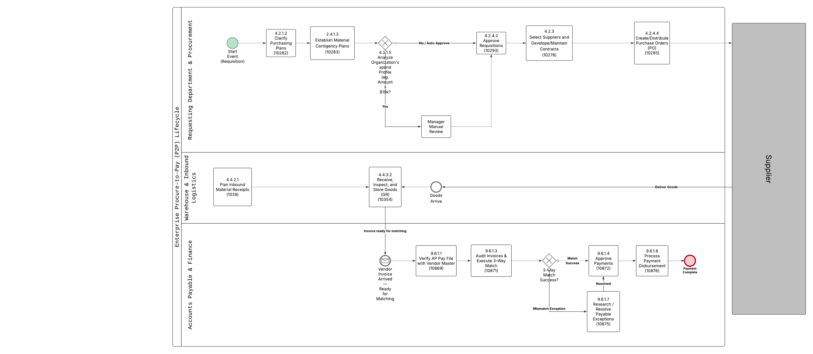
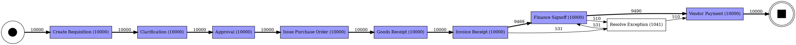
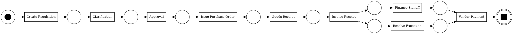
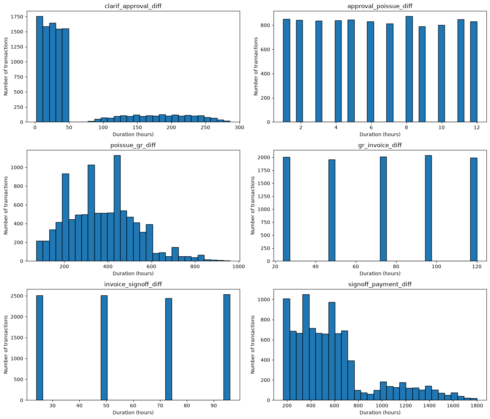
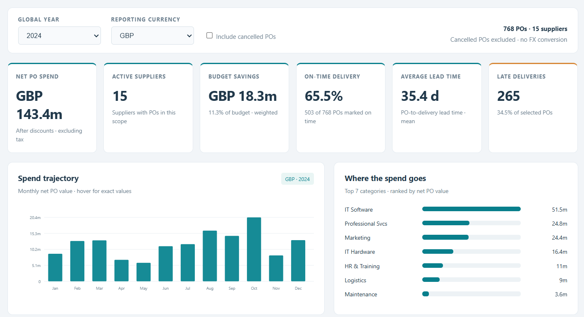

# Enterprise Procure-to-Pay (P2P) Process Optimization: APQC-Aligned BPMN, Python Process Mining, and Tableau BI Dashboard

[-orange?style=for-the-badge&logo=github)](https://github.com/)
[](https://www.python.org/)
[](https://pm4py.fit.fraunhofer.de/)
[](https://www.apqc.org/)
[-purple?style=for-the-badge&logo=tableau&logoColor=white)](https://www.tableau.com/)


Hey there! 👋 This repository captures my learning project exploring the end-to-end Procure-to-Pay (P2P) lifecycle. As someone looking to bridge the gap between business operations and data science (especially tailored for the Indian GCC and shared services space), I built this sandbox to practice process mining, SOP governance, and spend analytics from scratch.

This isn't a real enterprise deployment—it's a hands-on learning project where I combined traditional process frameworks with Python and AI-assisted tooling.

## Project Problem Statement & Executive Summary
### Context & Business Challenge:

Large enterprises frequently experience hidden operational bottlenecks, manual approval delays, and high invoice mismatch rates across fragmented Procure-to-Pay (P2P) lifecycles. Without standardized process visibility, organizations suffer from inflated procurement cycle times, delayed supplier payments, and missed early-payment cash discounts.

### Project Solution & Scope:

This project bridges enterprise business process management (BPM) with data science by designing a fully standardized P2P workflow aligned with APQC PCF v8.0 (spanning Categories 4.2 Procurement, 4.4 Inbound Logistics, and 9.6 Accounts Payable).

## 🛠️ What's Inside This Project?

The project is split into two main parts: a process mining pipeline built on custom synthetic data, and a spend/supplier analysis dashboard built using a public dataset.

1. Process Discovery & Bottlenecks (Synthetic Data & SOP 1)
 * **The Core P2P SOP**: Mapped out a 9-step workflow strictly aligned with APQC PCF v8.0 standards, detailing role handoffs, SLAs, and conditional logic (like $10k PR approval gates and 3-way match exceptions).

 * **Synthetic Event Log**: Since clean enterprise event logs are hard to find publicly, I wrote a Python script to generate a custom 10000-case dataset with 25+ granular system headers (Case_ID, Match_Status, timestamps, etc.).

 * **Process Mining (pm4py)**: I used Python's pm4py library to turn the event log into a Directly-Follows Graph (DFG), discover BPMN models.
 * **Bottleneck Analysis**: Scripts/Pipelines to uncover where operational bottlenecks happen (like exception-handling queues).

2. Spend & Supplier Performance Analysis (Kaggle Dataset & SOP 2)
 * To practice macro-level analytics, I used the "Purchase Orders & Supplier Performance Dataset" from Kaggle.

 * Connected this data to an AI-generated dashboard to analyze overall spend trends, supplier delivery reliability, order volumes, and cost variances without getting bogged down in manual drag-and-drop dashboarding.

## Project Structure

```text
Enterprise-P2P-Analytics/
│
├── data/
│   ├── Dataset_Procurement.xlsx   #Ready made data from Kaggle
│   ├── p2p_event_log.csv          #synthetic event logs generated
│   └── p2p_transaction_table      #synthetic complete p2p transaction data
│
├── dashboards/
│   └── p2p_overview       # P2P Dashboard using AI
│
├── documents/
│   ├── process_mining/    # contains diagrams
│   ├── apqc_pcf_bpmn.png  # BPMN diagram created using Lucidchart
│   ├── sop_1.md           # APQC PCF Style SOP
│   └── sop_2.md           # Mixed APQC PCF and Kaggle Dataset
│
├── notebooks/
│   ├── p2p_analytics.ipynb  # Analytics on Synthetic Data
│   ├── data_auditing.ipynb  # Kaggle dataset Auditing
│   ├── bn.py                # Bottleneck anlaysis script
│   └── synthetic.py         # Synthecic data generation script
│
├── README.md
└── requirements.txt
```
## 🚀 Tech Stack & Tools
* **Process Framework**: APQC Process Classification Framework (PCF v8.0) & Lucidchart architecture notes.

* **Data Generation & Process Mining**: Python (pandas, numpy, pm4py).

* **Analytics & Visualization**: AI-assisted dashboard generation (Tableau integration is planned for a future iteration!).

## 💡 Key Learnings
* **BPMN & SOP Documentation**: Learnt how to create BMPN diagrams and Different components of SOP Documentations.

* **The Process vs. The Data**: Realized quickly how messy process execution can look in data compared to clean flowchart boxes—especially when 3-way match mismatches introduce loops and rework.

* **Why Process Mining Matters**: Moving past static Excel reports to programmatically mining an event log makes spotting throughput bottlenecks much more intuitive.

## 🔮 Future Enhancements (What's Next?)
Since this is an ongoing learning project, here are a few things I plan to experiment with next:

1. **Tableau Dashboard Migration**: Replace the temporary AI-generated dashboard with a fully interactive Tableau dashboard to practice production-grade enterprise reporting and parameter actions.

2. **Conformance Checking**: Implement token-based replay in pm4py to measure exactly how often cases deviate from the ideal APQC SOP flow.

3. **Predictive Lead Times**: Train a lightweight machine learning model in Python to predict whether a purchase order will hit an exception queue (9.6.1.7) before it even reaches accounts payable.


## Project Gallery

### BPMN


### Process mining diagrams

1. **DGF**


2. **Petri Net**


### Process Time Distribution for identifying Bottlenecks


### Procurement Dashboard


## Thank You!
